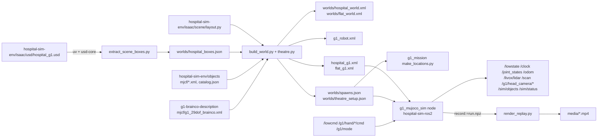

# g1-mujoco-sim: MuJoCo hospital world for the G1

This repository is the MuJoCo version of the Isaac hospital (`hospital-sim-env/isaac/usd/hospital_g1.usd`). It
uses the same world frame. The G1 29-DoF rev 1.0 with BrainCo Revo2 hands from `g1-brainco-description` is
placed in it. The repository holds the generator scripts and the generated scene files. The `g1_mujoco_sim`
ROS 2 node in `hospital-sim-ros2` loads these scenes. It runs them behind the real robot's low-level interface
(`/lowcmd`, `/lowstate`).

The scene generator needs two sibling repositories. The repository `hospital-sim-env` gives the room layout,
the extracted furniture boxes and the surgical objects. The repository `g1-brainco-description` gives the robot
MJCF. The master repository `hospital-sim` checks everything out side by side. It provides `env.sh`, which
activates the shared `.venv` with mujoco.

Paths in this README are relative to this repository unless they name a sibling repository or the master
(`env.sh`, `docs/interfaces.md`). Run the commands from the root of the master checkout.

## How it works

The script `build_world.py` generates the scenes. It imports `hospital-sim-env/isaac/scene/layout.py` by path
and builds the walls of the surgical wing analytically. Every room in `KIT_ROOMS` and `SUITE_ROOMS` gets
0.10 m (`WALL_T`) walls, 3 m high, inside its cell. The script cuts out every doorway in `DOORWAYS` and
`OPENINGS`.

The rest of the building comes from `worlds/hospital_boxes.json`. These are axis-aligned boxes in the world
frame, which `extract_scene_boxes.py` extracted once from the USD stage. There are 793 boxes: 354 building
walls, 248 building objects, 87 layout dressing items and 104 OR-suite props. The script cuts the building
walls again at the wing doorways. All world geoms are boxes in MJCF geom group 0, class `world`.

In the operating theatre, `theatre.py` adds the scrub-nurse set. With `--theatre auto` (the default) it
attaches the `hospital-sim-env/objects/mjcf/*.xml` assets with `<model>`/`<attach>` at the `catalog.json`
world poses. These assets are the instrument table, the tool rack, the surgeon mannequin and 7 instruments.
It removes the two OR stools that they replace. Without those assets it falls back to primitive stand-ins
(`standin`), and `none` leaves the theatre empty.

The theatre module emits one inactive weld `grip_<instrument>` per instrument for the simulated surgeon grip
in the simulator node. It writes the poses, the stances and the per-instrument grasp data of the set to
`worlds/theatre_setup.json`. The function `build_flat()` writes a checker floor. The function `spawns()` writes
named spawn poses in the world frame to `worlds/spawns.json`. It derives them from `layout.WING_ORIGIN` =
(17.93, -4.45). It places `theatre_table` 0.12 m behind the station and takes `theatre_handover` from the
setup file.

The function `robot_copy()` copies `g1-brainco-description/g1_29dof_brainco/mjcf/g1_29dof_brainco.xml` to
`g1_robot.xml`. It strips the floor, the lights, the skybox and `<visual>`, and rebases `meshdir` on this
folder. It records the source in `robot_source.txt`. A unitree_rl_gym file without hands is the marked
fallback when the canonical model is missing.

The function `scene()` writes `hospital_g1.xml` and `flat_g1.xml`. Each scene has:

- the `<model>` assets,
- an `<include>` of `g1_robot.xml` and the world,
- `<option timestep="0.002" integrator="implicitfast" cone="elliptic" impratio="10"/>`,
- `<size memory="64M"/>`,
- an inactive `fixed_base` weld on `pelvis`.

The option `--check` compiles both scenes with mujoco and prints their sizes (hospital: nq 107, nu 41,
1197 geoms, 63 bodies).

At run time, `g1_mujoco_sim/sim_node.py` (in `hospital-sim-ros2`) loads the scene named by its `model`
parameter. The file `sim.launch.py` sets that parameter to `$HG1_ROOT/g1-mujoco-sim/<world>_g1.xml`. The node
reads `worlds/spawns.json` and `worlds/theatre_setup.json` from the same folder. The class `ModelMap` finds the
29 body joints and their motors by name, so the node never slices qpos. The physics steps at the model
timestep, 0.002 s, paced to the wall clock.

Each step applies the latest `/lowcmd` like the G1 motor driver. The torque is `tau = tau_ff + kp (q_des - q)
+ kd (dq_des - dq)`, clipped to the joint torque limit. Motors in mode 0 give zero torque. The step sets the 12 hand
position actuators to `u * ctrlrange_upper`, calls `mj_step`, and publishes `/clock` and `/lowstate` at 500 Hz.
The node publishes decimated outputs at lower rates:

- `/joint_states` and `/odom` plus the TF `odom -> pelvis` at 100 Hz,
- the hand states at 50 Hz,
- `/sim/objects` at 10 Hz,
- `/sim/status` at 1 Hz.

The MID-360 model casts 200 rays per step with `mj_multiRay` against geom group 0 only. It publishes a
10 000-point `/livox/lidar` frame at 10 Hz in `mid360_link` (z down, as mounted). It also publishes a 720-beam
`/scan` in `laser_link`, a static TF rolled back by pi so that z is up. The head camera renders 640x360 RGB
and depth at 15 Hz in a separate process, only while a subscriber exists. A harness holds the pelvis at the
spawn until 2.5 s after `/g1/mode` becomes STAND, then fades out over 1 s. The parameter `record_path` saves
`(t, qpos)` at 30 Hz to an `.npz` file on shutdown, and `render_replay.py` renders that file offscreen to MP4.

## Architecture



This table lists the main pieces of the repository and the node that consumes them.

| Piece | File | Role |
|---|---|---|
| World generator | `build_world.py` | wing walls from `layout.py`, building and furniture boxes, theatre set, spawns, robot copy, scene files; `--check` compiles; `--theatre auto\|objects\|standin\|none`; `--robot PATH` overrides the robot MJCF |
| Theatre set | `theatre.py` | objects mode (attach `hospital-sim-env/objects` assets at `catalog.json` poses, cameras `theatre_station`, `theatre_closeup`, `theatre_handover`) and stand-in mode (table, free 4-slot rack, 4 box instruments, surgeon stand-in); writes `theatre_setup.json` |
| Box extractor | `extract_scene_boxes.py` | world-frame AABBs of `/World/Hospital` (ground floor, door openings cut), `/World/Wing/Dressing`, `/World/Wing/ORSuite/Props` from the USD stage into `worlds/hospital_boxes.json`; skips items smaller than 6 cm, flatter than 12 cm or with their bottom above 1.4 m |
| Replay renderer | `render_replay.py` | `.npz` from `sim.launch.py record:=...` to MP4 with a follow camera or named MJCF cameras side by side, optional caption |
| Scenes | `hospital_g1.xml`, `flat_g1.xml` | what the sim node loads |
| Sim node (consumer) | `ros2_ws/src/hospital-sim-ros2/g1_mujoco_sim/g1_mujoco_sim/sim_node.py` | physics loop, motor model, sensors, harness, fixed base, objects, stubs (`lidar.py`, `model_map.py`, `scene_objects.py`, `head_camera.py`, `stubs.py`) |

## Dependencies

This table lists the system dependencies.

| Item | Version here | Needed for |
|---|---|---|
| Ubuntu | 22.04.5 LTS | |
| Python (`.venv`, system interpreter with system site-packages) | 3.10.12 | all scripts |
| `uv` | 0.12.19 | `extract_scene_boxes.py` only (`usd-core` is not in `.venv`) |
| ROS 2 Humble (`rclpy`, `tf2_ros`, `sensor_msgs`, `nav_msgs`, `geometry_msgs`, `std_msgs`, `std_srvs`, `rosgraph_msgs`, `builtin_interfaces`) + colcon, CycloneDDS (`rmw_cyclonedds_cpp`) | apt | the `g1_mujoco_sim` node, `g1_interfaces` and the vendored `unitree_hg` messages in `hospital-sim-ros2` |
| GPU with EGL (RTX 3070, driver 580 here) | | offscreen head-camera rendering and `render_replay.py` (`MUJOCO_GL=egl`); `build_world.py` and the physics need no GPU |
| ffmpeg | bundled 7.0.2 | `render_replay.py` uses the binary shipped by `imageio-ffmpeg`; no apt ffmpeg needed |

This table lists the third-party Python imports of the scripts in this repository. The versions come from the
`.venv` freeze `venv_local.txt`, and `requirements.txt` pins them.

| Package | Version | Used by | Notes |
|---|---|---|---|
| `mujoco` | 3.14.0 | `build_world.py --check`, `render_replay.py`, the sim node | `g1-whole-body-rl` uses mujoco 3.10.0 in its conda env `g1-mjx`; the scenes here are only used with the `.venv` version |
| `numpy` | 1.26.4 | `theatre.py` (camera `look_at`), `render_replay.py`, the sim node | |
| `imageio` | 2.38.0 | `render_replay.py` | MP4 writer |
| `imageio-ffmpeg` | 0.6.0 | `render_replay.py` | ffmpeg binary for imageio |
| `opencv-contrib-python` (`cv2`) | 4.10.0.84 | `render_replay.py --label` | caption only |
| `usd-core` (`pxr`) | 26.8 resolved by `uv` on 2026-10-10 | `extract_scene_boxes.py` | not installed in `.venv`; run through `uv run --no-project --with usd-core` |

The scripts `build_world.py` and `theatre.py` otherwise use only the standard library (`argparse`,
`importlib.util`, `json`, `math`, `os`, `sys`, `glob`, `xml.etree.ElementTree`). Writing the XML needs neither
mujoco nor USD. This repository reads no YAML. The repository `hospital-sim-env` reads `placements.yaml` and
turns it into `catalog.json`.

This repository needs no data or assets outside git. The file `worlds/hospital_boxes.json` is committed, so a
rebuild does not need the USD stage. A re-extraction needs `hospital-sim-env/isaac/usd/hospital_g1.usd`. That
stage references the NVIDIA Isaac Sim 6.0 assets and the Isaac for Healthcare (i4h) catalog 0.7.0 (see
`hospital-sim-env/isaac/README.md`). The objects mode needs `hospital-sim-env/objects/mjcf/*.xml` and
`catalog.json`. The script `hospital-sim-env/objects/build.sh` generates them there from the i4h instrument
meshes.

## Install

Run these commands from a fresh clone of the master repository. The steps are:

1. Clone the master repository and enter it.
2. Install `vcstool` and import every component repository.
3. Create `.venv` only if it does not exist yet; `env.sh` activates it.
4. Source `env.sh` and install the pinned Python packages into `.venv`.
5. Build `ros2_ws` with colcon for the `g1_mujoco_sim` node and its messages, then source `env.sh` again.

```bash
git clone https://github.com/Bkrakshith/hospital-sim.git Hospital_G1
cd Hospital_G1
pip install vcstool
vcs import < hospital-sim.repos
python3 -m venv --system-site-packages .venv       # only if .venv does not exist yet; env.sh activates it
source env.sh
.venv/bin/pip install -r g1-mujoco-sim/requirements.txt
(cd ros2_ws && colcon build --symlink-install) && source env.sh    # the g1_mujoco_sim node and messages
```

The generated scenes are committed, so no build step is needed to run the simulator. Rebuild the scenes after
the robot MJCF, `layout.py`, `hospital_boxes.json` or the objects change. The rebuild takes about 1 s.

```bash
source env.sh
.venv/bin/python g1-mujoco-sim/build_world.py --check          # about 1 s
```

## Run

Rebuild and check the scenes. The command regenerates `worlds/*.xml`, `worlds/spawns.json`,
`worlds/theatre_setup.json`, `g1_robot.xml`, `hospital_g1.xml`, `flat_g1.xml` and `robot_source.txt`. It then
compiles both scenes.

```bash
source env.sh
.venv/bin/python g1-mujoco-sim/build_world.py --check
```

The first line of the expected output is `world geoms: {'wing_wall': 41, 'building_wall': 355, 'furniture': 437,
'theatre_set': 'objects: 7 instruments'}; robot: g1-brainco-description/...`. The next two lines are
`hospital_g1.xml: nq=107 nv=99 nu=41 ngeom=1197 nbody=63` and `flat_g1.xml: nq=58 nv=57 nu=41 ngeom=145
nbody=53`. Add `--theatre standin` or
`--theatre none` to change the theatre set. The option `--theatre objects` fails with a message if the
`hospital-sim-env/objects` assets are missing.

Re-extract the building boxes. The command rebuilds `worlds/hospital_boxes.json` from the USD stage. Run it
only after `hospital-sim-env/isaac/scene/build_hospital.py` changes the stage. It prints a count per category
and the number of door openings found. Then run `build_world.py` again.

```bash
uv run --no-project --with usd-core python g1-mujoco-sim/extract_scene_boxes.py
```

Open the scene in the MuJoCo viewer without ROS. The robot starts at the pelvis pose of `g1_robot.xml` (not a
spawn) and collapses, because nothing drives the motors.

```bash
.venv/bin/python -m mujoco.viewer --mjcf g1-mujoco-sim/hospital_g1.xml
```

Run the simulator with ROS 2. The file `sim.launch.py` runs the simulator node with the controller and the
mode manager. Without `viewer:=true` it sets `MUJOCO_GL=egl` for the head camera. The other launch arguments
are `effort_limits:=auto|model|ultra` (auto picks from the policy sidecar), `camera:=false` and
`policy:=<name>`.

```bash
ros2 launch g1_bringup sim.launch.py                                    # headless hospital, default spawn corridor_west
ros2 launch g1_bringup sim.launch.py viewer:=true world:=flat           # flat floor with the MuJoCo viewer
ros2 launch g1_bringup sim.launch.py spawn:=link                        # or spawn:="x,y,yaw" (world frame)
ros2 launch g1_bringup sim.launch.py fixed_base:=true spawn:=theatre_table   # pelvis welded: arm-skill development
ros2 launch g1_bringup sim.launch.py record:=/tmp/run.npz               # save (t, qpos) at 30 Hz on shutdown
ros2 run g1_teleop_keyboard keyboard_node                               # own terminal: r, l, w/a/s/d/q/e, p, m, n, o, x
ros2 launch g1_bringup mission.launch.py                                # scrub-nurse mission (g1_mission README)
```

Render a recording. The command renders an `.npz` recording offscreen to MP4 (libx264, crf 30). Without
`--camera`, a smoothed follow camera tracks the pelvis. With `--camera`, the script renders the named MJCF
cameras side by side. It prints the frame count and the file size.

```bash
MUJOCO_GL=egl .venv/bin/python g1-mujoco-sim/render_replay.py /tmp/run.npz out.mp4 [--t0 10 --t1 45] \
    [--size 640x352] [--fps 25] [--camera theatre_station,theatre_handover] [--label "text"]
```

## Test / check

Run the scene check. The expected result is exit 0 and the two `nq=... ngeom=...` lines above.

```bash
source env.sh
taskset -c 0-7,10-31 .venv/bin/python g1-mujoco-sim/build_world.py --check
```

Both scenes compile without warnings. When nothing upstream changed, the regenerated files are byte-identical
to the committed ones (`git status` in this repository stays clean).

The tests of the simulator node live in `hospital-sim-ros2`. Run
`colcon test --packages-select g1_mujoco_sim && colcon test-result --all` from `ros2_ws`. The tests cover the
scene-object logic and the `/clock` stamp rounding described below.

## Layout

This table lists the files and folders of the repository.

| Path | What |
|---|---|
| `build_world.py` | generates every XML and JSON below from `hospital-sim-env/isaac/scene/layout.py`, `worlds/hospital_boxes.json`, the robot MJCF and the objects |
| `theatre.py` | the scrub-nurse set (objects mode or stand-ins), used by `build_world.py` |
| `extract_scene_boxes.py` | USD stage to `worlds/hospital_boxes.json`; needs `usd-core` through `uv` |
| `render_replay.py` | recorded run (`.npz`) to MP4 |
| `requirements.txt` | pinned Python dependencies for the shared `.venv` |
| `hospital_g1.xml`, `flat_g1.xml` | the scenes to load: `<model>` assets, robot plus world, `timestep 0.002`, `implicitfast`, elliptic cones, `fixed_base` weld |
| `g1_robot.xml` | generated copy of the robot MJCF: world-level geoms, lights and skybox stripped, `meshdir` rebased |
| `robot_source.txt` | which robot file `g1_robot.xml` came from and whether it was the fallback |
| `worlds/hospital_world.xml`, `worlds/flat_world.xml` | world-only MJCF, included by the scenes (835 geoms in the hospital world) |
| `worlds/hospital_boxes.json` | extracted AABBs (793 boxes), input to `build_world.py` |
| `worlds/spawns.json` | named spawn poses per world (world frame) |
| `worlds/theatre_setup.json` | generated: theatre set world poses, `station` and `handover_station` stances, per-instrument `grasp_z`, `handle_z`, `grasp_range`, `approach_axis`, mass; `g1_mission/scripts/make_locations.py` turns it into the mission config |
| `media/g1_hospital_walk.mp4` | stand-up, 12 s keyboard walk down the surgical corridor, stop, MANIP arms and hands, blend-out, e-stop (0.4 MB) |
| `media/e2e_report_hospital.json` | the end-to-end check report for that run |
| `media/g1_scrub_nurse_fixed_base.mp4` | fixed-base scrub-nurse run through the full ROS stack: pick from the rack, carry, fixed-base glide to the surgeon, handle-first handover, back to the table (0.7 MB) |
| `media/g1_placeholder_walk_corridor.mp4` | earlier recording of the placeholder policy walking the corridor (2.5 MB) |

## Interfaces to other repositories

The contract is `docs/interfaces.md` in the master repository (section 1 layout, section 3.1 topics, section 6
autonomy). This table lists what this repository reads from its siblings.

| From | Path | Used for |
|---|---|---|
| `hospital-sim-env` | `isaac/scene/layout.py` | rooms, doorways, `WING_ORIGIN`, `WALL_T` (imported by path) |
| `hospital-sim-env` | `isaac/usd/hospital_g1.usd` | box extraction only |
| `hospital-sim-env` | `objects/mjcf/*.xml`, `objects/catalog.json` | theatre set in objects mode (`<model>` paths in `hospital_g1.xml` are relative: `../hospital-sim-env/objects/mjcf/`) |
| `g1-brainco-description` | `g1_29dof_brainco/mjcf/g1_29dof_brainco.xml` | copied to `g1_robot.xml`; meshes stay in that repository (`meshdir="../g1-brainco-description/g1_29dof_brainco/mjcf"`) |
| `g1-brainco-description` | `g1_29dof_brainco/robot_spec.json` | read by the sim node for `effort_limit_ultra` when `effort_limits:=ultra` |

This table lists what this repository provides.

| To | What |
|---|---|
| `hospital-sim-ros2` `g1_mujoco_sim` | `<world>_g1.xml` (parameter `model`, default `$HG1_ROOT/g1-mujoco-sim/<world>_g1.xml`), `worlds/spawns.json`, `worlds/theatre_setup.json` |
| `hospital-sim-ros2` `g1_mission` | `worlds/theatre_setup.json` through `scripts/make_locations.py` (locations and instruments config) |
| ROS graph (through the sim node) | `/lowstate`, `/clock`, `/joint_states`, `/odom`, TF `odom -> pelvis`, `/sim/ground_truth` (world frame), `/g1/hand/{left,right}/state`, `/livox/lidar`, `/scan`, `/g1/head_camera/{image_raw,depth,camera_info}`, `/sim/objects`, `/sim/status`; services `/sim/reset`, `/sim/harness`, `/sim/reset_objects`; subscribes `/lowcmd`, `/g1/mode`, `/g1/hand/{left,right}/cmd`, `/sim/fixed_base_goal` |

## World contents

- The wing comes from `layout.py` and is exact. Every room of `KIT_ROOMS` and `SUITE_ROOMS` gets 0.10 m walls
  inside its cell, 3 m high, like the kit. The generator cuts out every opening in `layout.DOORWAYS` and
  `OPENINGS` (2 m clear).
- The Isaac hospital building comes from the USD and is approximate. It consists of the ground-floor walls, cut
  at every door frame, plus the furniture and the stairs, as axis-aligned boxes. The building is grid-aligned,
  so the boxes are close. The extractor leaves out the door leaves (the doors are open). It skips the floors,
  the ceilings, the trims and the lights.
- The furniture is the layout dressing (87 items) and the OR-suite props (104, minus the 2 stools that the
  surgeon replaces). The extractor skips items smaller than 6 cm, items flatter than 12 cm, and items with their
  bottom above 1.4 m. Examples of the last group are ceiling lights and high wall signs.
- The floor is one plane at z = 0.

The totals in objects mode are 41 wing walls, 355 building walls and 437 furniture boxes. All static world
geoms are in geom group 0. The robot MJCF uses groups 2 (visual), 3 (collision) and 4 (sites). The simulated
lidar sees only group 0.

## Scrub-nurse set (theatre)

The command `build_world.py --theatre auto` (the default) uses the `hospital-sim-env/objects` assets when its
`mjcf/*.xml` and `catalog.json` exist. Otherwise it falls back to the primitive stand-ins in `theatre.py`.

Objects mode (current):

- The generator attaches the objects with MuJoCo `<model>`/`<attach>` at the `hospital-sim-env/objects/catalog.json`
  world poses. Those poses come from `hospital-sim-env/objects/placements.yaml`. The set has 7 instruments as
  free bodies and the static 7-slot tool rack on a Mayo-style instrument table. It also has the static surgeon
  mannequin with the `surgeon_hand` site.
- The generator leaves the two OR-suite surgical stools that the surgeon replaces out of the box world.
- The file `hospital_g1.xml` declares the `<model>` assets itself. With MuJoCo 3.4, `<model file>` paths inside
  an included file resolved differently depending on the working folder.

Stances (mission `config/locations.yaml`):

- The stance `theatre_instrument_table` is (25.58, -20.12, facing south), 0.40 m from the rack row. The
  repository `hospital-sim-env/objects` suggests 0.33 m. With the policy's default arms, the fingertips reach
  0.42 m forward and would sit in the rack.
- The stance `theatre_surgeon_side` is the `hospital-sim-env/objects` stance (23.80, -18.25, facing south).
  The surgeon's hand is 0.45 m ahead and 0.20 m to the right.
- The two stances are 2.6 m apart, so the mission carries the instrument between them. In fixed-base mode the
  base glides (see below).
- The spawn `theatre_table` (fixed base) is 0.12 m behind the table stance. The robot stands up there and
  raises its arms, and FineAlign moves it in.

Stand-in mode (`--theatre standin`):

- The set has a table, a free 4-slot rack (1.2 kg) and 4 box instruments (`scalpel_handle`, `forceps`,
  `needle_driver`, `scissors`) with the sites `<name>_grasp` and `<name>_handle`.
- A surgeon stand-in has its hand reachable from the table stance. The file `theatre_setup.json` then has
  `"standin": true`.

The simulator node `g1_mujoco_sim` has these simulator-only extras (ground truth or cheats, see `g1_mission/README.md`):

- The topic `/sim/objects` publishes JSON at 10 Hz: `{name: {"pose": [x,y,z,qw,qx,qy,qz], "type": "instrument" |
  "rack" | "surgeon_hand", ...}}`. It covers every free object, the rack (`"static": true` if it is static) and
  the surgeon's hand. Instruments also carry `"held_by": "surgeon" | null`, and the hand carries
  `"holding": <name> | null`.
- The service `/sim/reset_objects` (`std_srvs/Trigger`) puts every object back. The parameter `object_offset`
  `[dx, dy, dyaw]` shifts the rack and its instruments rigidly for trials. A static rack moves through
  `body_pos`.
- The simulated surgeon grip is a weld. The weld `grip_<name>` (solref 0.004) activates when a handle end rests
  within 4.5 cm of `surgeon_hand`. Resting means that the handle end moves slower than 8 cm/s (0.3 s low-pass)
  for 0.6 s. The surgeon holds one instrument at a time. When another instrument that is out of its rack slot
  comes within 0.40 m of `surgeon_hand`, the held one goes back to its slot. That other instrument is the robot
  arriving with the next one.
- Until 2026-09-30 the held instrument went back only when the surgeon gripped the next one. It still lay
  welded along the previous handover axis, so in sessions without `/sim/reset_objects` (the iPad app) the next
  instrument jammed against it. Example: angled_tweezers after needle_driver, then scissors stopped 5 cm to
  9 cm from the hand, and the mission reported "surgeon did not take the instrument".
- The hand and forearm geoms of the mannequin within 0.22 m of the site are contact-free. A rigid hand cannot
  yield, and the weld does the gripping.
- The argument `fixed_base:=true` welds the pelvis at the spawn pose, 0.78 m high (`fixed_base_height`), and
  turns off the harness. The weld point is the pelvis origin. At the world origin, a milliradian of yaw error
  drifted the pelvis 5 cm.
- The topic `/sim/fixed_base_goal` (`geometry_msgs/PoseStamped`) glides the welded base in a straight line to
  another stance. The base moves at 0.3 m/s, lifts 3 cm midway, and does no collision checking. The glide
  stands in for walking in fixed-base mode, and whatever the hands hold travels with the base.
- The physics option is `cone="elliptic" impratio="10"`, which `hospital-sim-env/objects` also asks for.
  Instrument jitter in a closed Revo2 hand dropped from 4.6 cm/s to 1.6 cm/s RMS.

The head RGB-D camera is the MJCF camera `head_d435` at `d435_link`, with `fovy` 42 deg:

- The topics are `/g1/head_camera/image_raw` (rgb8, 640x360, 16:9), `/depth` (16UC1 mm, aligned) and
  `/camera_info`. The intrinsics match the Isaac backend: fovy 42 deg, fx = fy = 468.9, cx 320, cy 180. The
  frames are in `d435_color_optical_frame` (parameter `camera_frame`), with a static TF from `d435_link`. Isaac
  stamps its optical-convention images with `d435_link`, so a consumer that uses TF must know which one it has.
- The RTF and rate numbers below were measured at 640x480.
- The camera renders only while someone subscribes. It renders in a separate process (`head_camera.py`), fed
  with qpos through shared memory. A render thread inside the simulator process starved the 500 Hz Python
  physics loop through the GIL (RTF 0.60, 8.8 fps).
- The library rosidl validates `uint8[]` byte by byte, about 50 ms per 640x480 frame. The node bypasses this
  by assigning an `array('B')`. The same fix went into the lidar cloud.
- The fixed-base theatre stack (simulator, controller, manager, mission) measured RTF 1.00 and a mean step of
  about 1.2 ms, with and without a camera subscriber. The camera runs at 14.7 Hz to 15 Hz, with 8 ms of render
  plus publish for RGB and depth (RTX 3070, EGL).

## Frame and spawns

The world frame is the Isaac world frame. The wing origin (the SE door, west edge of the link corridor) is at
`(17.93, -4.45, 0)`. A wing-local (x, y) maps to the world (x + 17.93, y - 4.45). This table lists the named
spawns in the hospital world.

| Spawn | World (x, y, yaw) | Where |
|---|---|---|
| `corridor_west` (default) | (8.93, -12.45, 0) | Surgical corridor, west end, facing east. More than 20 m of 4 m-wide corridor ahead, so it is the best place to walk |
| `link` | (18.93, -5.65, -pi/2) | Link corridor inside the SE door, facing south into the wing (2 m wide) |
| `lobby` | (18.93, -1.95, -pi/2) | Hospital SE lobby, 2.5 m north of the SE door, facing the door |
| `theatre_table` | (25.58, -20.00, -pi/2) | Operating theatre, 0.12 m behind the instrument-table stance (fixed-base mission spawn) |
| `theatre_handover` | (23.80, -18.25, -pi/2) | Operating theatre, handover stance beside the surgeon |

Pass `spawn:=link` or `spawn:="x,y,yaw"` to `sim.launch.py`. The `odom` frame starts at the spawn pose, like a
real odometry source. The topic `/sim/ground_truth` gives the pose in the world frame. The flat world has one
spawn, `origin`.

## Measurements on this machine (RTX 3070, 32 threads)

- The call `mj_step` took about 110 us with the 980-geom hospital of that time. The MID-360 slice (200 rays per
  step, 10 000 points per 10 Hz frame) costs about 360 us. The 720-beam `/scan` costs about 0.76 ms, once
  every 50 steps.
- The whole simulator loop, including ROS publishing, takes 1.35 ms to 1.5 ms mean per 2 ms step. The RTF is
  0.99 to 1.00 with the full stack (simulator, controller, manager, robot_state_publisher). It dropped to about
  0.91 in one run while Isaac Sim and an MJX training job loaded the CPU at the same time.
- The topics `/lowstate` and `/lowcmd` run at 500 Hz. The policy runs at 50 Hz.

## Fix of 2026-09-30: /clock stamps

The node `g1_mujoco_sim` stamped t = 6.9999999999 as 6.0 s. That value is the float sum of 0.002 s steps. The
expression `int(t)` + `round(frac) % 1e9` sent `/clock` back by 1 s once every few simulated seconds. Every
C++ tf2 buffer (AMCL, Nav2) then "detected a jump back in time" and cleared itself. The node
robot_state_publisher warned "Moved backwards in time" every second.

The node now rounds the stamps once in integer nanoseconds (`_stamp()` in `sim_node.py`). A test in
`g1_mujoco_sim/test` covers it. Earlier Nav2 runs on the simulator were affected.

## Known limits

- The hospital building geometry is AABB-approximate. The wing is exact to `layout.py`.
- The generator leaves out the ceiling, so the world is open from above in the viewer.
- The lidar intensity is constant. There is no noise model yet on the IMU or the lidar.
- The script `build_world.py` falls back to unitree_rl_gym's `g1_29dof_rev_1_0.xml` (no hands) when the
  canonical robot MJCF is missing. It then marks `g1_robot.xml` and `robot_source.txt` as a fallback. The
  simulator node then echoes hand commands as hand state.

## License

The license of this repository is the Apache License, Version 2.0 (see `LICENSE`).
You can use, change and share this work, also for commercial use.
If you share this work or a work that you built on it, keep the `NOTICE` file.
Give this credit in your documentation and product credits: "Based on hospital-sim by Bkrakshith (https://github.com/Bkrakshith/hospital-sim)".
To cite this work in a publication, use `CITATION.cff`.
Some third-party parts keep their own licences. The `NOTICE` file lists them.
